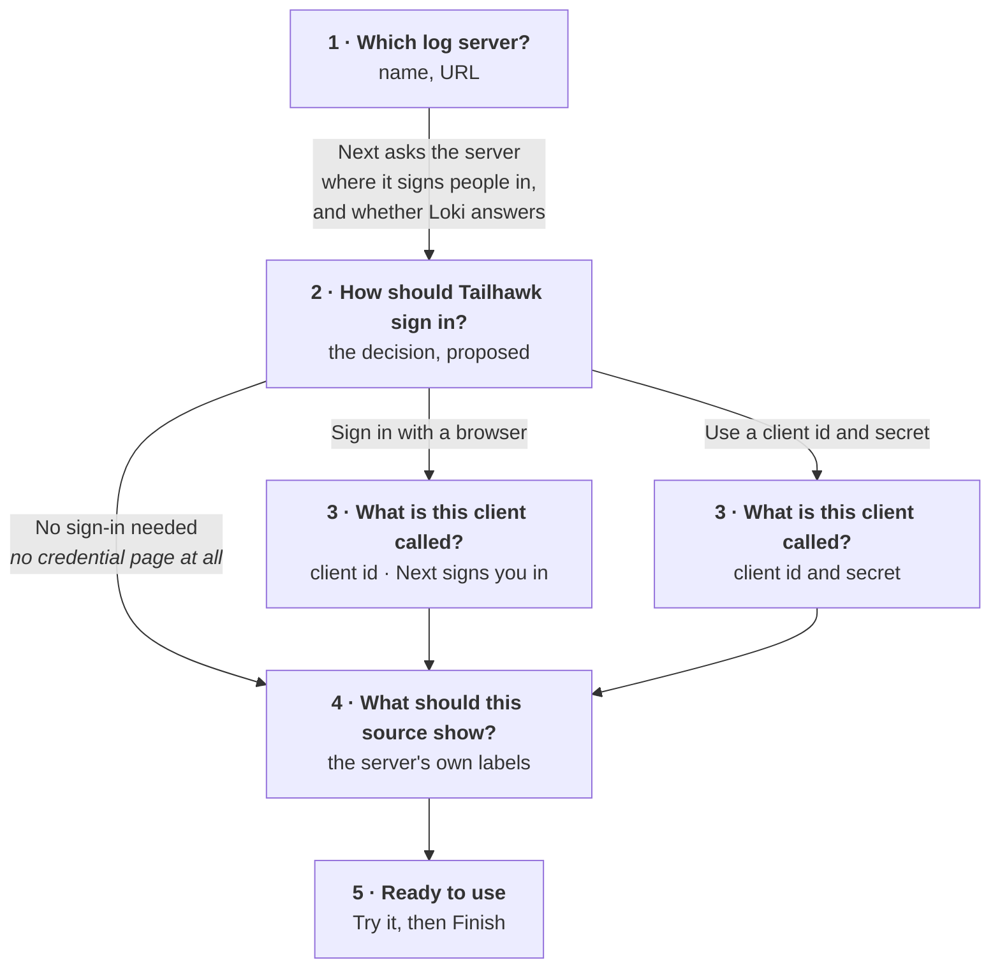

# The Remote sources wizard — the flow

The five pages are `sources-wizard.rc` beside this file, which the Visual Studio dialog designer
opens: **File ▸ Open ▸ File…** on the `.rc`, then double-click a page in the Resource View. Nothing
in the build reads it — Tailhawk writes its dialogs as `Item` lists in
`crates/tailhawk/src/dialog.rs`, because a `.res` would put a resource compiler in the build — so
the `.rc` is a drawing you can push controls around in and hand back.

Every decision below is already written and tested in `crates/tailhawk-core/src/sourcesetup.rs`.
The pages are what that state machine looks like.

## What is built, as of 2026-10-21, and what is still a drawing

**Built:** the tree (`IDD_SOURCES`), a source's own screen, and a tail's own screen. The model split
behind them — a source is a connection, a tail is a view — is in
`crates/tailhawk-core/src/sourceset.rs` and `settings.rs`, with the migration that reads an old
file.

**Still a drawing:** the five wizard pages. `New source…` opens the source *form*, not the wizard;
`Draft::steps`, `Step` and `can_ask_server` have no consumer yet. The commit that landed the
two-level dialog said so plainly and this says so too, because a document that reads as though the
wizard exists is how a session comes to believe it does.

**Superseded by the split:** page 4, *"What should this source show?"*. A selector and a list of
applications are what a **tail** is, so that page is a tail's screen rather than a step of a
source's setup — and `Add tail…` is one page, which is what the fifth row of the table below
would have been. The argument in *What the wizard can do that the form cannot* survives intact and
in fact gets stronger: by the time a reader is adding a tail, the source is configured and signed
in, so `Choose…` always has a server to ask.

## Why a wizard rather than a form

The owner, 2026-10-21, rejecting a form with eleven fields on it:

> I dont really understand the screen you have created, the discover button is just sitting there,
> and all the fields next to it. that is not like the analogy I gave you of setting up email where
> the user simply adds an email, or has an advanced option.

and then the sentence that makes it a state machine rather than five fixed pages:

> the decisions about login modes would modify later screens in this 'Wizard' style dialog.

**The login mode is a fork, not a setting.** A browser sign-in needs a client id and never a secret.
A client-secret source needs both. A Loki that wants neither needs no credential page at all. A
wizard that asks everyone for everything is the rejected form, one page at a time.

## The flow



## What each page does, and what stops it

| Page | Next does | Next is refused when |
|---|---|---|
| **1 Which log server?** | Asks the server for its OpenID configuration, and asks the Loki URL itself whether it answers — both on a worker, with the page greyed while they run | No name; a name that starts or ends with a space or holds anything but letters, digits, spaces, `-`, `_` and `.`; no URL; a URL that is not `https://` |
| **2 How should Tailhawk sign in?** | Nothing but move on — the decision is the page | No token URL, on the two modes that need one; no sign-in URL, on the browser one |
| **3 What is this client called?** | Signs you in, on the browser path | No client id; a secret box you have cleared, on the one mode that uses it |
| **4 What should this source show?** | — | **Superseded**: this is a tail's screen now, reached by `Add tail…`. See above. |
| **5 Ready to use** | **Finish** adds the source | Never, by this point |

## The three things that are properties of the code, not of the drawing

**Changing your mind takes the other path's fields with it.** `Source::signs_in` is literally
`!auth_url.is_empty()`, so carrying a sign-in URL into a client-secret source would use the flow you
had just rejected. `Draft::into_source` drops what the chosen mode has no use for, and
`Draft::secret_to_forget` gives up a stored secret that the new mode will never send.

**Every page complains about itself and nothing else.** `Draft::blocking(step)` is per page, which
is what keeps a reader from being held on page 1 by a missing client id — the wall of fields again,
one page at a time. The flat editor asks `Draft::fault()` instead, which is every page's complaint
at once plus `Source::fault`'s, because a form shows every box together and owes them every answer
together.

**The counter tells the truth.** `Draft::steps()` is computed, so a credential page that is going to
be skipped was never one of the five. "Step 2 of 4" means four.

## What the wizard can do that the form cannot

Page 4 is the whole argument. A label list costs a credential; on a flat form, the moment the reader
fills in what to show is a moment when nothing knows whether the source can be reached at all — so
the box has to be free text and the reader has to already know the answer. By page 4 the mode is
settled and the credential is in hand, so there is something to ask.
`Draft::can_ask_server()` is the predicate, and when it is false the page says so and takes text.

## What stays a form

**Edit…** keeps the flat screen. Changing one field of a working source should not be five pages of
ceremony, and by then every answer the wizard gathers has already been given.

**And `Add tail…` is one page, not a wizard.** A tail is three facts — which source, a name, a
selector — and the first of them is settled by the row the reader was standing on. There is no fork
in it: nothing a reader can answer on that page changes what the page asks next, which is the whole
reason the source setup needs a wizard and this does not.

## The tree — the owner's shape, 2026-10-21

> so instead of a simple list, we would have a list of sources, each of which might be a node on a
> tree with the tails unerneath them. Then the user can either add a new source, or can add a tail
> to the source.

```
telemetry.nurtur.tech
    ndc
    identity server
    job dispatcher
```

Five verbs beside it: `New source…`, `Add tail…`, `Edit…`, `Clone`, `Delete`, and `Close`.

**Why the tree and not a list with a column.** The list it replaced had six columns — name, URL,
query, applications, secret, problem — which was the old model drawn out: a row carried both halves
because a row *was* both halves. The tree says the one thing the columns could not, which is *which
tails read which server*, and it is the thing that matters: the credential follows the **source**,
and one entry per view had been giving one Loki three credentials for the same server, the same
client and the same person.

**What a row says, now that there are no columns to say it in.** `sourceset::node_label` appends
`(no secret stored)` to a source that wants a client secret and has none, and `— <fault>` to any row
that cannot be used. Both were columns before. A source that signs the reader in through a browser is
never told it is missing a secret, because it has none and never will.
